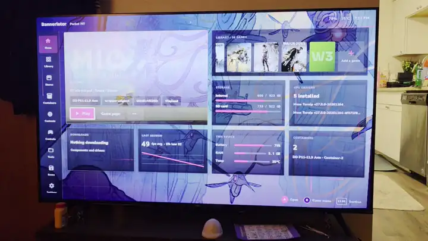

# Bannerlator 3.1.9-pre2

Run Windows apps and games on Android — no PC and no root required.

&nbsp;&nbsp;&nbsp;&nbsp;&nbsp;&nbsp;

**3.1.9-pre2 is a test build of everything since 3.1.9-pre1: Lab, a new interface style made for controllers, in 32 languages and with your game art behind it; a first-run setup that can download and create your first container; each game's Wayland logs in its own folder with Share logs; and a fix for the file manager crash on phones that list a folder twice (#659).**

- **Lab:** a dashboard home, Library, Stores, game pages, settings, Contents, Controls, Save Manager and one in-game menu, all for a controller (touch works too).
- **Game art:** the selected game's art behind Home and the Library, 3D art, trailers in Home's big tile, and a Game details page to pick each picture.
- **First-run setup:** new installs start in Lab with the Carbon & Ember theme, and a setup step downloads Proton, DXVK, VKD3D, FEXCore and a driver for your GPU and creates a container.
- **Languages:** Lab in 32 languages (Appearance › Language).
- **Wayland logs:** each game's Wayland logs in its log folder, and Share logs sends the folder as one zip.

<!-- update-summary: Bannerlator 3.1.9-pre2: Lab interface style for controllers (dashboard home, Library, Stores, game pages, settings, Contents, Controls, Save Manager, one in-game menu) in 32 languages; game art backgrounds, 3D art and trailers with a Game details page; first-run setup in Lab with Carbon & Ember and a step that creates your first container; Wayland adapter settings and help buttons in Lab; per-game Wayland logs and Share logs; file manager crash fix (#659). -->
<!-- update-highlight: Lab style | A controller-first interface: dashboard home, Library, Stores, game pages, settings and one in-game menu. -->
<!-- update-highlight: Game art | The selected game's art behind Home and the Library, 3D art, trailers, and a Game details page. -->
<!-- update-highlight: First container | Setup downloads Proton, DXVK, VKD3D, FEXCore and a driver for your GPU, then creates a container. -->
<!-- update-highlight: 32 languages | Lab's screens, settings and explanations in 32 languages (Appearance › Language). -->
<!-- update-highlight: Wayland logs | Each game's Wayland logs in its own folder; Share logs sends the folder as one zip. -->

> ✅ **Nothing to set up.** Update the app; containers and games keep everything. An update keeps the interface style and theme you have: Lab and Carbon & Ember are only the start for new installs (Settings › Appearance › Interface Style offers Lab to everyone).

> ⬇️ **Small update.** With **Include pre-releases (beta builds)** switched on in Settings, the in-app updater downloads about **34 MB** on 3.1.9-pre1, about **68 MB** on 3.1.8 and about **40 MB** on the 3.1.8 Mali test build, instead of the whole app (about 597 MB). Older versions, first installs and this page give the full APK.

> ⚠️ **A test build.** Not tried on a device before this pre-release: starting a game in a container made by the setup step, the setup step with an x86_64 Proton (Box64) or on a phone without an Adreno GPU, "System" on Wayland on a Mali phone, and the 32 languages screen by screen. Please report what misbehaves, with a screenshot.

# What's New — since 3.1.9-pre1

## 🧪 Lab interface style

- **Settings › Appearance › Interface Style** now offers **Lab** next to Classic, Deck and XMB: a dashboard home (a big tile for the selected game, your recent games, storage and quick actions), a rail in landscape and a drawer in portrait (swipe from the left edge).
- **Library and Stores** pages, a **game page** with quick settings, and a game menu that slides in (long press a game, or ⋯).
- **Settings** as Lab menus laid out like the Classic editors (same tabs, order and every option): app settings with Performance, Saves & cloud and Logs tabs; container, New container, All containers and game settings.
- **Contents** (components, download sources, installed items), **Controls** (on-screen profiles, controller bindings, player slots) and the **Save Manager**, as Lab pages.
- **One in-game menu** instead of the quick menu and the full menu: Quick first, then every page, a little under half the screen.
- **For the controller:** L2/R2 change tabs everywhere, a ▶ launch and ⋯ options button on list rows, a visible focus on every row and button. Dialogs take Lab's look.
- **In the settings:** a faint line between options, a **?** beside every setting that has an explanation (or START on the focused row), and the **Wayland adapter settings** of Classic's gear — profile (Auto, Smooth, Fast, Compatibility), the single switches (present mode, asynchronous copy, zero-copy, client render fences, UBWC, DRM format modifiers, KGSL timing shim, subgroups) and the **adapter report** at the top of the Wayland game driver page.

> ✅ **Device-tested** on the Pocket FIT Elite (Adreno 830) through these builds: Home, Library, game pages, container and game settings, the row lines, the **?** buttons, the adapter settings and report. Not every page was gone through with a controller.

## 🖼️ Game art

<i>Lab on the Pocket FIT, on a TV: MIO's art behind Home and its trailer playing in the big tile. <a href="https://github.com/The412Banner/Bannerlator/releases/download/3.1.9-pre2/Bannerlator-3.1.9-pre2-game-art-preview.mp4">Watch the video (9 s, MP4)</a>.</i>

- **Game art background** (Settings › Appearance, on by default in Lab): the selected game's art fills Home and the Library behind the panels, and stays on its game page. Panels over the art can be Solid, Glass or Clear, with the grid on or off.
- **3D art** (a slow drift of the art in depth) and **previews** (the game's trailer, muted unless you switch the sound on, behind Home's big tile; on Wi-Fi only unless you change it).
- Pictures come from the game's linked Steam app, else from a Steam search by name, else from **SteamGridDB**, so games from other stores get sharp backgrounds too.
- **Game details** (a game's ⋯ menu): rename, link it to a Steam app, and pick its Cover, Wide cover, Background, Logo and Icon from Steam, SteamGridDB or a file; the logo's place and size; the preview clip; and the game's own background settings.
- **Library cards:** covers, wide covers or icons, in three sizes.

> ✅ **Device-tested** on the Pocket FIT (the preview above, on a TV) and the Pocket FIT Elite: the game's art behind Home and the Library, its trailer in Home's big tile, 3D art and Game details.

## 🚀 First-run setup

- **New installs start in Lab** with the **Carbon & Ember** theme and **100 %** interface and text size. Updates keep their style, theme and sizes.
- **Your first container** (a new step after the base system install): pick from lists with a recommended choice each — **Proton** (latest DroidDeck Proton arm64ec), **DXVK** (dxvk-gplasync 2.4.1 pre-reg), **VKD3D** (latest stable), **FEXCore** (latest -unix build), **WOWBox64** (latest Hybrid nightly) and a **Banners-Turnip driver** matched to your Adreno GPU (Banners-AIO). Name, display backend (Wayland when the Proton supports it), FEXCore and WOWBox64 presets, DirectAudio with the microphone, the 60 fps limiter, Show FPS and all CPU cores are set too. Create downloads it all and makes the container.
- **Portrait:** the steps show as a row of circles at the top.
- **Allow notifications** works on Android 13 and newer (it opens the app's notification settings, as the app can't show Android's prompt).

> ✅ **Device-tested** on the Pocket FIT Elite with fresh installs: Lab with Carbon & Ember from the first screen, the step circles, the notifications button, and the container step (every pick and setting checked in the created container). Starting a game in that container was not tried.

## 🌐 Lab in 32 languages

- **Appearance › Language** changes Lab's screens, settings names, options and explanations: العربية, Български, Čeština, Dansk, Deutsch, Ελληνικά, Español (España and Latinoamérica), Suomi, Français, हिन्दी, Magyar, Bahasa Indonesia, Italiano, 日本語, 한국어, Bahasa Melayu, Norsk bokmål, Nederlands, Polski, Português (Brasil and Portugal), Română, Русский, Svenska, ไทย, Türkçe, Українська, Tiếng Việt and Chinese (Simplified, Hong Kong, Taiwan).
- Corrections are welcome: each language is one file, `app/src/main/res/values-<language>/strings_lab.xml`.

> ⚠️ **Not gone through screen by screen** in each language.

## 🌊 Wayland logs and Mali

- **Each game's Wayland logs** go to its own log folder (`wayland/`, one per run), shown as "Wayland" in View logs and counted by the Log Manager.
- **Share logs** (View logs, in every game menu) zips the game's whole log folder and opens Android's share sheet.
- **Mali:** "System" on Wayland now runs the game on the phone's own driver (it fell back to a bundled Turnip before).

> ✅ **Device-tested** on the Pocket FIT Elite: the Wayland logs and Share logs. ⚠️ No Mali device here: the Mali change was not tried on a Mali phone.

## 🔧 Smaller

- **File manager:** no crash on phones whose storage lists a folder twice ([#659](https://github.com/The412Banner/Bannerlator/issues/659)); such a folder is shown, searched and sized once. The Containers screen's folder picker is fixed the same way.
- **Session FPS:** each session's frame rate is counted and saved even with the overlay off (Settings › Performance › Save FPS of each session, on by default); with it off, Lab's tiles show playtime instead.
- **Containers:** a new container shows in Add a game straight away, and the container editor's Create / Save buttons work by touch.
- **Back button:** a page that handles B itself no longer gets a second back.

## ⚠️ Carried over — still open

- **Lab** is new: please report anything that looks or navigates wrong, with a screenshot.
- The file manager crash fix could not be reproduced here (our devices don't list folders twice).
- Everything listed as open in 3.1.9-pre1 is unchanged.

<b>📦 Where to get Proton 9</b> (tap to expand)

The APK does not bundle Proton 9 — Wine installs from the in-app catalog on first run. The Linux Steam client does not use these layers at all: its games run through Valve's own ARM64 Proton.

**Proton 9.0 arm64ec** — not bundled, download it if you want it:

**https://github.com/The412Banner/Nightlies/releases/download/Proton/wine/proton-9.0-arm64ec.wcp**

66.7 MB · sha256 `f8a99fed387f1b097009129dc49368c8f500927640a9d4c7a192d850b1b2068c`
Install it via **Containers → download icon → install the `.wcp`**. It also appears in the in-app catalog. *(Compiled as a wcp by **Xnick417x**.)*

---

<b>🙏 Credits</b> (tap to expand)

**3.1.9-pre2:** game art comes from **Steam**'s store assets (Valve) and from **SteamGridDB** and its artists; the per-game artwork choices follow **DroidDeck**'s artwork editor by **Kurt Himebauch (xXJSONDeruloXx)**. Previews play with Google's **Media3 / ExoPlayer** (Apache-2.0). The setup step's catalogs are the **winlator-contents** and **Nightlies** lists, with **DroidDeck-Proton**, **dxvk-gplasync**, **VKD3D-Proton**, **FEX-Emu**, **box64** (**ptitSeb**) and **Banners-Turnip** (Mesa Turnip). The Wayland adapter settings are Classic's gear on **Pipetto-crypto**'s bionic Vulkan wrapper. Thanks to **jebran0987** for reporting the file manager crash ([#659](https://github.com/The412Banner/Bannerlator/issues/659)).

Everything credited in 3.1.9-pre1 still applies, including **MGamer404**'s XMB style, Epic and Ubisoft fixes, **BFE**'s file manager and unpack engines and their tool authors, the Mali work by **GunaCharanTeja (Fcharan)**, **leegao**, **zenithblue-oss** and **FristOneRR**, **REFramework** by **praydog** and **Special K** by **Andon M. Coleman (Kaldaien)**.

---

*Entirely app-side — no ImageFS reinstall. Install over 3.1.9-pre1 or 3.1.8; everything carries over.*
