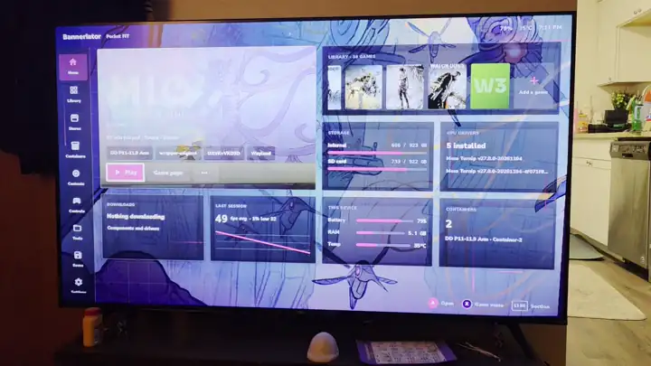

# Bannerlator 3.2.0

Run Windows apps and games on Android — no PC and no root required.

&nbsp;&nbsp;&nbsp;&nbsp;&nbsp;

**3.2.0 is everything since 3.1.8: a new controller-first Lab interface, a reworked XMB with a Steam Deck-style Home, the Windows Steam client, one look for every store with download locations and importing the games you already have, a new file manager and text editor, menu sounds, and the Xbox store on Nexus 0.2.15.** It also brings mods per game, yserver as an optional X server, 2× WFG frame generation and many store fixes.

- **Lab interface:** a dashboard home, game pages, settings, Contents and one in-game menu built for a controller, with game art behind them, 32 languages and a first-run setup that downloads what a new container needs.
- **XMB update** (by **MGamer404**): a Steam Deck-style Home, Stores, Downloads and Friends on one tabs page, a new in-game menu, and touch everywhere.
- **Windows Steam client:** add Valve's 64-bit Steam client to a container; the games from Bannerlator's Steam store show as installed in it, and it can start in Big Picture.
- **Stores:** one look for Steam, Epic, GOG, Amazon and Xbox, a download location for each store, and **+ Import game library** turns game folders you already have into installed games.
- **File manager and text editor:** archives that open like folders, two panes, a text editor that keeps a file's encoding, and more formats to unpack.

<!-- update-summary: Bannerlator 3.2.0: new Lab interface; XMB with a Steam Deck-style Home (MGamer404); Windows Steam client; one look for every store with download locations and game library import; new file manager and text editor; menu sounds; Xbox on Nexus 0.2.15. -->
<!-- update-highlight: Lab interface | A controller-first dashboard, game pages, settings and one in-game menu, with game art, 32 languages and a first-run setup. -->
<!-- update-highlight: XMB update | A Steam Deck-style Home, Stores, Downloads and Friends on one tabs page, and a new in-game menu (by MGamer404). -->
<!-- update-highlight: Windows Steam | Add Valve's 64-bit Steam client; your Steam store games show as installed, and it can start in Big Picture. -->
<!-- update-highlight: Stores | One look for every store, a download location per store, and + Import game library for folders you already have. -->
<!-- update-highlight: File manager | Archives that open like folders, two panes, a text editor, and more formats to unpack. -->

> ✅ **Nothing to set up.** Update the app; containers and games keep everything. An update keeps your interface style and theme — Lab and Carbon & Ember are only the start for new installs (try Lab or XMB in Settings › Appearance › Interface Style). Each container unpacks its extra libraries once more on its first start after the update (a few seconds).

> ⬇️ **Small update.** On 3.1.8 the in-app updater downloads about **93 MB**; on 3.1.9-pre2 about **51 MB** and on 3.1.9-pre1 about **59 MB** — instead of the whole app (about 601 MB). Older versions, first installs and this page give the full APK.

> ⚠️ **Not tried on a device in this release:** the XMB update, the file manager, the text editor and the new unpack formats, the Mali changes, the per-game Epic fixes and the fixes from El_Espectro's thread. Please report what misbehaves, with a screenshot.

# What's New — everything since 3.1.8

## 🔁 What changes when you update

- **Stores look new in every interface**, Classic and XMB included: card views, full-art game pages, Steam's Add to Library on the game page. The Steam game page no longer shows the Online pill.
- **Touch** and **Aim mode** replace Relative Mouse and Cursor to Touch. Your old choice carries over; the new default is Aim Auto.
- **Steam downloads follow the app's language**, and optional DLC is skipped.
- **XMB draws at its own size** (100 %) with its own size sliders, and no longer follows the phone's Display size or Font size.
- **Menu sounds** are off until you switch them on (Settings › Sounds).
- **Games see the device's name as their computer name** (some online games need it). `HOSTNAME_FIX_DISABLE=1` in a game's environment turns it off.
- **New internal Amazon installs** go to drive Z:.
- **Lab:** controller settings moved to a **Controller** tab in container settings.
- The app is about **5 MB bigger** (yserver is included).

## 🧪 Lab interface style

- **Settings › Appearance › Interface Style** now offers **Lab** next to Classic, Deck and XMB: a dashboard home (a big tile for the selected game, your recent games, storage and quick actions), a rail in landscape and a drawer in portrait (swipe from the left edge).
- **Library and Stores** pages, a **game page** with quick settings, and a game menu that slides in (long press a game, or ⋯).
- **Settings** as Lab menus laid out like the Classic editors (same tabs, order and every option): app settings with Performance, Saves & cloud and Logs tabs; container, New container, All containers and game settings.
- **Contents** (components, download sources, installed items), **Controls** (on-screen profiles, controller bindings, player slots) and the **Save Manager**, as Lab pages.
- **One in-game menu** instead of the quick menu and the full menu: Quick first, then every page, a little under half the screen.
- **For the controller:** L2/R2 change tabs everywhere, a ▶ launch and ⋯ options button on list rows, a visible focus on every row and button. Dialogs take Lab's look.
- **In the settings:** a faint line between options, a **?** beside every setting that has an explanation (or START on the focused row), and the **Wayland adapter settings** of Classic's gear — profile (Auto, Smooth, Fast, Compatibility), the single switches (present mode, asynchronous copy, zero-copy, client render fences, UBWC, DRM format modifiers, KGSL timing shim, subgroups) and the **adapter report** at the top of the Wayland game driver page.
- **Matches Classic:** mods, Library sort and filter and removing several games at once, Contents search and repositories with **Set as default** and Undo, a container's layer update and revert, save backup and restore, and Appearance sizes from 50 to 150 %.
- **In-game menu:** shows the game's art, icon and logo (Game details can pick separate in-game pictures), reopens on the page you left, and an open list takes the highlight.
- **+ Download from source** in the setting pickers (with Cancel), store badges on the cards, and Contents refreshes after a download.
- **Fits any size:** Lab shrinks to fit at large display sizes; the side rail and Home scroll when they still don't fit (big text), and tile text wraps instead of being cut.
- **Display server** switch (X server or yserver) at the top of Advanced in container and game settings, and a **Controller** tab in container settings.
- Tapping the app icon brings back the page you left, and a game started from its home-screen icon counts as played.

> ✅ **Device-tested** on the Pocket FIT Elite (Adreno 830) and the Pocket FIT: Home, Library, game pages, container and game settings, the **?** buttons, the adapter settings and report, the in-game art, Download from source, the fit and scroll at display sizes 345–540 and text sizes 0.85–2.0, and the Display server switch and Controller tab.

## 🖼️ Game art

<i>Lab on the Pocket FIT, on a TV: MIO's art behind Home and its trailer playing in the big tile. <a href="https://github.com/The412Banner/Bannerlator/releases/download/3.1.9-pre2/Bannerlator-3.1.9-pre2-game-art-preview.mp4">Watch the video (9 s, MP4)</a>.</i>

- **Game art background** (Settings › Appearance, on by default in Lab): the selected game's art fills Home and the Library behind the panels, and stays on its game page. Panels over the art can be Solid, Glass or Clear, with the grid on or off.
- **3D art** (a slow drift of the art in depth) and **previews** (the game's trailer, muted unless you switch the sound on, behind Home's big tile; on Wi-Fi only unless you change it).
- Pictures come from the game's linked Steam app, else from a Steam search by name, else from **SteamGridDB**, so games from other stores get sharp backgrounds too.
- **Game details** (a game's ⋯ menu): rename, link it to a Steam app, and pick its Cover, Wide cover, Background, Logo and Icon from Steam, SteamGridDB or a file; the logo's place and size; the preview clip; and the game's own background settings.
- **Library cards:** covers, wide covers or icons, in three sizes.

> ✅ **Device-tested** on the Pocket FIT (the preview above, on a TV) and the Pocket FIT Elite: the game's art behind Home and the Library, its trailer in Home's big tile, 3D art and Game details.

## 🚀 First-run setup

- **New installs start in Lab** with the **Carbon & Ember** theme and **100 %** interface and text size. Updates keep their style, theme and sizes.
- **Your first container** (a new step after the base system install): pick from lists with a recommended choice each — **Proton** (latest DroidDeck Proton arm64ec), **DXVK** (dxvk-gplasync 2.4.1 pre-reg), **VKD3D** (latest stable), **FEXCore** (latest -unix build), **WOWBox64** (latest Hybrid nightly) and a **Banners-Turnip driver** matched to your Adreno GPU (Banners-AIO). Name, display backend (Wayland when the Proton supports it), FEXCore and WOWBox64 presets, DirectAudio with the microphone, the 60 fps limiter, Show FPS and all CPU cores are set too. Create downloads it all and makes the container.
- **Portrait:** the steps show as a row of circles at the top.
- **Allow notifications** works on Android 13 and newer (it opens the app's notification settings, as the app can't show Android's prompt).

> ✅ **Device-tested** on the Pocket FIT Elite with fresh installs: Lab with Carbon & Ember from the first screen, the step circles, the notifications button, and the container step (every pick and setting checked in the created container).

## 🌐 Lab in 32 languages

- **Appearance › Language** changes Lab's screens, settings names, options and explanations: العربية, Български, Čeština, Dansk, Deutsch, Ελληνικά, Español (España and Latinoamérica), Suomi, Français, हिन्दी, Magyar, Bahasa Indonesia, Italiano, 日本語, 한국어, Bahasa Melayu, Norsk bokmål, Nederlands, Polski, Português (Brasil and Portugal), Română, Русский, Svenska, ไทย, Türkçe, Українська, Tiếng Việt and Chinese (Simplified, Hong Kong, Taiwan).
- Corrections are welcome: each language is one file, `app/src/main/res/values-<language>/strings_lab.xml`.

## 🎮 XMB

By community contributor **MGamer404** (#638 in 3.1.9-pre1 and #660 now) — thank you.

- **Settings › Appearance › Interface Style › XMB:** a console-style interface for controllers, now with a **Steam Deck-style Home** — your library as one row of covers over the art of the game you're on, the latest game as a big wide card; press A and its options slide in underneath.
- **Stores, Downloads and Friends on one tabs page** (press Down from the games, or swipe up). Downloads shows what's downloading, with pause, resume and cancel for Steam and Epic.
- **A game's Settings** opens its Shortcut settings page over the game's blurred art; your own changes for that game are marked, with **Reset to container**.
- **In-game menu** in XMB's look: one drawer with the frame limiter, screen, controls and the rest, as Lab has.
- **On-screen keyboard** made for controllers and touch, also inside games (the keyboard button, or Select + X).
- **Touch everywhere**, a gliding highlight, menu sounds on every page, **Y search** that works with a controller, and pop-ups redesigned for a landscape phone.
- **Its own size:** XMB draws at a fixed size with its own Interface scale and Font size, so the phone's Display size can't break its layout.

## 🖥️ Windows Steam client

- **Add the Windows Steam client** (64-bit) from Valve, on internal storage or the SD card. It gets a badge and sits first in the library; removing its shortcut offers to uninstall it.
- **Your games in Steam:** games installed through Bannerlator's Steam store show as installed in the client (a shared library folder on each drive), and your other games appear in it as non-Steam games.
- **Start in Big Picture** (a switch), with Big Picture's menus drawn on the GPU; the Menu button acts as Steam's Guide button.
- The 64-bit client starts without manual fixes. Bannerlator sets Steam up for it: X11 and the 64-bit fix, a SteamLibrary folder on each drive that has none, and your games in Steam's list.

> ✅ **Device-tested** on the Pocket FIT (adding the client, store games shown as installed, Big Picture) and the Pocket FIT Elite (the 64-bit client starting, the Menu button).

## 🛒 Stores

- **One look for every store** (Steam, Epic, GOG, Amazon, Xbox) in every interface: card views, a tap opens the game's page, full-art game pages with the cover beside the Install button, and a download line with speed and time left.
- **Download location** for each store: internal storage, an SD card or USB drive, or a folder you pick, with a default for each store. Updates stay in their folder, and cancelling an update no longer deletes the installed game.
- **+ Import game library** (Steam, Epic, GOG, Amazon): folders of games you already have become installed games. Only missing files download, and an imported folder is never deleted. Steam also offers **Use a folder I already have**.
- **Game names in your language** for Steam, GOG and Xbox, also on Lab's tiles.
- **Repairs:** a game whose folder moved repairs its shortcut when it starts, stale Downloads rows go away, the exe pick skips macOS leftovers (`._*.exe`), and a GOG import stops with a message instead of installing somewhere else.

> ✅ **Device-tested** on the Pocket FIT Elite (download locations and import for all four stores, the repairs) and the Pocket FIT (the store pages, names in Chinese).

## 🟦 Steam

- **Games download and run in the app's language**, with a choice per game; optional DLC is skipped.
- **Cloud saves** tab works on the default download engine.
- A compact **download speed** picker that fits landscape, and download bar text you can read over the fill.

> ✅ **Device-tested:** *Counter-Strike 2* in Chinese on the Pocket FIT; the Cloud saves tab and the download bar on the Pocket FIT Elite.

## ⬛ Epic and Ubisoft

- **Epic downloads** no longer stop with "Download failed" (#657, **MGamer404**), show their size and speed, and can be paused and resumed (#660, **MGamer404**).
- **Ubisoft games from Steam and Epic:** when the container has no Ubisoft Connect yet, Bannerlator offers to set it up before the game starts (#658, **MGamer404**).
- **Per-game fixes now apply** (*Hogwarts Legacy*, *Oblivion*, *Fallout 3*, *Fallout: New Vegas*, *Kingdom Hearts III*), and *Trover Saves the Universe* gets one.
- **Manifest, sign-in and library sync fixes**, no false "Up to date", and games start in the app's language.
- **Online games:** a computer-name fix for games that use Epic Online Services.

> ✅ **Device-tested:** *Metalstorm* starts and signs in to Epic's online services on the Pocket FIT.

## 🟩 Xbox

- **The newer Xbox backend** (Nexus 0.2.15) and **runtime** (11.0-20261102), with their sign-in, cloud-save and DLC fixes; DLC now mounts for games the app starts.
- **Search** also asks xbox.com, so console-first PC games show up (*Knights of the Old Republic*, *Conker*, *Halo*).

> ✅ **Device-tested** on the Pocket FIT: library sync with Game Pass, the cloud-gaming sign-in, a download and launch (*Brotato*) with in-game sign-in, and search. The 25 original-Xbox games on PC are small launchers that most likely won't run.

## 🧱 Display, X server and frame generation

- **yserver**, a newer X server included in the app, as an option per container or game (Advanced › Display server). The HUD shows the game's real frame rate on it.
- **The X server** no longer crashes the app on requests it doesn't know, and a game stays in front of console windows.
- **Mouse:** 7-button mice, button releases go to the right window, and Wine gets a certificate bundle (for HTTPS in games).
- **WFG frame generation** (2×), a third frame-generation engine, with a guard against added input lag.

> ✅ **Device-tested** on the Pocket FIT: games and the Windows Steam client on yserver, the X server fixes, WFG on Wayland.

## 🎯 Controls, drivers and components

- **Touch:** Touchpad, Direct or Touchscreen, and **Aim mode** Auto, On or Off (they replace Relative Mouse and Cursor to Touch; your choice carries over). Fixes the view spinning after a touch.
- **Driver installs** say where the driver went or why it was refused, and offer **Download and replace**.
- **Box64EC** uses the version the settings show.

> ✅ **Device-tested:** Touch and Aim on Wayland on the Pocket FIT Elite; Box64EC on the Pocket FIT; the driver messages partly on the Elite.

## 🔊 Menu sounds

- **Settings › Sounds:** menu sounds from Steam's Big Picture pack or a DeckThemes / Audio Loader pack, in one **Sound pack** list (Preview, Apply, Delete, + Install a pack). Off by default.

> ✅ The Big Picture pack on the Pocket FIT Elite.

## 🗂️ A new file manager

The File Manager is rebuilt, in the look of **BFE** (Banners File Explorer). It is the same screen under the File Manager tab, Deck's Tools › Files, the Log Manager's folder view, and every "choose a file / folder" screen in the app.

- **Home:** tiles for internal storage and SD cards (used / total), Downloads, Pictures, Documents, Games, each container's C: drive, the system drive (Z:) and your Favorites.
- **Getting around:** tap any part of the path to jump there; Back, Up and Home on the toolbar; list, compact or grid; folders and files each keep their own sort order (names with numbers sort in number order); search the folder, or every folder below it; hidden files on or off.
- **Select** with a long press, then copy, cut, move, compress (zip or 7z), share, rename or delete. Copying shows its progress, can be cancelled, and asks what to do when a name already exists.
- **Two panes** side by side in landscape (⋮ › Two panes), with Copy over and Move over.
- **Archives open like folders** (zip, 7z, rar, tar, iso and the other formats 7-Zip lists): open a file inside, or take out only what you select, next to the archive, into a new folder, into the other pane or anywhere. Password-protected archives ask for the password.
- Each file's ⋮ menu keeps **Run** (in a container), **Add to Games**, **Fast Extract** and **Unpack**, and adds Open as text, Open with, Compress, Share, Copy path and Properties (with the Windows Read-only and Hidden flags).
- **Controller:** X on a row opens its menu and Select ticks it; in the Deck and XMB styles X is the toolbar menu and Y is search.

## 📝 Text viewer and editor

- **.ini, .cfg, .txt, .log, .json, .xml, .reg** and other text files open in a viewer that stays smooth with big logs: find, line numbers, wrapping and text size.
- **Edit** (the pencil) for files up to 4 MB: undo and redo, a row of symbol keys above the keyboard, and colours for ini, cfg, json, xml and scripts.
- **Save keeps the file as it was written:** UTF-8 or UTF-16 (many Windows .ini files are UTF-16), its byte-order mark and its Windows or Linux line endings.
- A file inside an archive opens read-only.

## 📦 More formats to unpack

- **New formats:** lzip, lzop, LZ4, ECM CD images, ALZ and EGG (Korean archives), ACE, Amiga LZX, and Android OTA `payload.bin` (choose the partitions). The 7-Zip formats Bannerlator didn't offer before (msi, arj, lzh, chm, deb, rpm, apk, vmdk, vdi, qcow, squashfs and more) work too.
- **FreeArc repacks with extra layers:** the Unpack screen reads the archive's layers before it starts and decodes the precomp ones itself. A layer it can't decode is named, and running the installer in a container is still offered.
- **Unpack and delete as it goes** (a switch on the Unpack screen, off by default): for a download too big to keep next to what it unpacks.

## 🧩 Mods per game

- A game's settings have a **Mods** section: **REFramework** (for RE Engine games) and **Special K**, downloaded from Bannerlator's own ARM64EC builds, plus **Start with the game** for a program such as a trainer or Cheat Engine.
- The in-game drawer has a **Mods** tab with a card per mod (its build, its DLL, 32/64-bit and a button for its menu). REFramework's menu also opens with L3 + R3.
- **Switching a mod off removes its files** from the game folder right away (Special K's logs too; its .ini settings stay), so the game starts as if it was never there.

> ✅ **Device-tested** on the Pocket FIT: Special K on *Ninja Gaiden Sigma* (switched off: its files gone and the .ini kept; switched on again: back in place, 60 fps). REFramework and Special K together ran in *Resident Evil 2* during development; not re-run on this build.

## 🟠 Mali GPUs

Everything from the **3.1.8-mali-pre1** test build, now in the regular app, plus a fix for its crash:

- **PanVK driver downloads** on Mali: PanVK-kbase by **zenithblue-oss** (made for Bannerlator), **FristOneRR**'s PanVK and **GunaCharanTeja**'s PanVK G615.
- **Faster BCn layer** (Fcharan's build of leegao's BCn layer), a checkbox in the container's graphics driver settings on Mali. **New:** with the default wrapper it crashed the container (#642 and testers' reports), so Bannerlator now uses the GameNative wrapper for that launch, as WinlatorMali does.
- A **newer DX12 compat layer** (leegao) for "Wrapper + compat + bcn".
- **GPU % and clock in the HUD** on the newer Mali GPUs (G310 to G925 and Immortalis) from the GPU's own counters, plus MediaTek and Tensor fallbacks.
- The X11 renderer uses a high-priority queue and a valid buffer format on Mali.
- Community configs show how many Mali devices tried a config.

## 🌊 Wayland logs and Mali

- **Each game's Wayland logs** go to its own log folder (`wayland/`, one per run), shown as "Wayland" in View logs and counted by the Log Manager.
- **Share logs** (View logs, in every game menu) zips the game's whole log folder and opens Android's share sheet.
- **Mali:** "System" on Wayland now runs the game on the phone's own driver (it fell back to a bundled Turnip before).

> ✅ **Device-tested** on the Pocket FIT Elite: the Wayland logs and Share logs.

## 🖥️ HUD, cursor and drivers

- **GPU load and clock in the HUD without root** on Adreno phones where Android blocks the GPU files.
- **Auto-hide Cursor** switch and **Hide After (ms)** in the drawer's Controls › Mouse; with it off, a game can't hide the pointer either. A finger always brings the pointer back (Wayland).
- **Driver cards** in Contents › Download Components say which Adreno GPUs each driver is for, read from its name; no label when the name doesn't say.
- **MIO: Memories in Orbit** and **UNCHARTED: Legacy of Thieves Collection** get Turnip's SSBO emulation by themselves (they need it on Adreno 7xx).

> ✅ **Device-tested:** the HUD reader on the Retroid Pocket Duo (Adreno 722); the cursor switch on the Pocket FIT Elite; *MIO* on the Pocket FIT (Adreno 750).

## 🔧 Smaller

- **File manager:** no crash on phones whose storage lists a folder twice ([#659](https://github.com/The412Banner/Bannerlator/issues/659)); such a folder is shown, searched and sized once. The Containers screen's folder picker is fixed the same way.
- **Session FPS:** each session's frame rate is counted and saved even with the overlay off (Settings › Performance › Save FPS of each session, on by default); with it off, Lab's tiles show playtime instead.
- **Containers:** a new container shows in Add a game straight away, and the container editor's Create / Save buttons work by touch.
- **Back button:** a page that handles B itself no longer gets a second back.
- FEX presets **Unreal Engine 3** and **Performance (full x87)**, from WinlatorMali, at the end of the preset list.
- The registry editor no longer crashes when a key can't be written.
- **From El_Espectro's thread:** Cancel really stops component downloads; WOWBox64 is kept when switching between arm64ec layers; downloaded versions show straight away in the game dialog; the translator chip is right; picture-in-picture keeps the game running; Task Manager's memory updates; the Controls menu shows the on-screen pad.

## ⚠️ Carried over — still open

- **XMB update:** not tried on a device yet. The Steam game page lost its Online / reconnect pill (every interface), and the plain Deck in-game menu picked up XMB's scroll spacing.
- **Lab:** at the largest text sizes the app Settings page still shortens names; a controller can't scroll inside Home's tiles.
- **yserver:** typing, the clipboard, frame generation and HDR not tried; OpenGL only works through EGL.
- **WFG:** not tried on X11; there is no target frame rate setting.
- **Steam:** optional DLC is always skipped (no opt-in yet); a language Steam refuses is still named on the game page.
- **Stores:** Epic and Amazon names stay in English; the sign-in, Downloads and Friends screens keep the old look; the library count doesn't refresh after an import; Amazon uninstall has no confirmation.
- **Xbox:** a game with DLC and the save-conflict choice not tried; offline play is not wired up; original-Xbox games on PC most likely won't run.
- **Epic:** region codes and Epic's cloud saves are not done; the computer-name fix most likely does nothing on x86_64 Wine (Box64).
- **Windows Steam client:** playing a linked store game from inside Steam not tried.
- **Drivers** installed before this release show "Installed" only after downloading them again.
- **Not tried on a device:** the file manager, the text editor, the new unpack formats, the Mali changes, the per-game Epic fixes and the fixes from El_Espectro's thread.
- Everything listed as open in 3.1.8 is unchanged.

<b>📦 Where to get Proton 9</b> (tap to expand)

The APK does not bundle Proton 9 — Wine installs from the in-app catalog on first run. The Linux Steam client does not use these layers at all: its games run through Valve's own ARM64 Proton.

**Proton 9.0 arm64ec** — not bundled, download it if you want it:

**https://github.com/The412Banner/Nightlies/releases/download/Proton/wine/proton-9.0-arm64ec.wcp**

66.7 MB · sha256 `f8a99fed387f1b097009129dc49368c8f500927640a9d4c7a192d850b1b2068c`
Install it via **Containers → download icon → install the `.wcp`**. It also appears in the in-app catalog. *(Compiled as a wcp by **Xnick417x**.)*

---

<b>🙏 Credits</b> (tap to expand)

**3.2.0:** the XMB update (#660) is by community contributor **MGamer404** — thank you. **yserver** (MIT) is by **Jos Dehaes**, with the Wayland host by **SetZero** (joske/yserver #349). The Xbox store now runs on **Nexus** by **Dominik Svoboda (domsvoboda)**: nexus-backend 0.2.15 (GPL-3.0, a fork of Xodus), nexus-runtime 11.0-20261102 and nexus-xgameruntime (LGPL-2.1). **WFG** is **qwertypower**'s frame generator from **WinNative** (MIT), and the present-queue guard follows WinNative PR #797. From **GameNative**: the computer-name fix and Wine's certificate bundle (#2009 by **Cole McCarren**), the *Trover* fix (#1953 by **Mo Kakwan (Wavewash)**), button releases (#2110 by **tapionallanaire**), and the Epic fix list from its gamefixes. The 7-button mouse map is **Seldom (teldommm)**'s (Pipetto-crypto/winlator #120), and the Present notifications follow **StevenMXZ**'s Ludashi work on **brunodev85**'s Winlator. The Touch / Aim idea came from **Max (MaxsTechReview)** (DroidDeck #2053, #2280). Menu sounds use **Valve**'s Steam Big Picture sounds and the Audio Loader format by **EMERALD0874**, with packs from **DeckThemes**. The Windows Steam client is **Valve**'s, downloaded from Valve. Reports from **El_Espectro**, **Dante**, **Ajay**, **babizigames**, **ziqing_0501** and **Nn** led to fixes in this release.

**3.1.9-pre2:** game art comes from **Steam**'s store assets (Valve) and from **SteamGridDB** and its artists; the per-game artwork choices follow **DroidDeck**'s artwork editor by **Kurt Himebauch (xXJSONDeruloXx)**. Previews play with Google's **Media3 / ExoPlayer** (Apache-2.0). The setup step's catalogs are the **winlator-contents** and **Nightlies** lists, with **DroidDeck-Proton**, **dxvk-gplasync**, **VKD3D-Proton**, **FEX-Emu**, **box64** (**ptitSeb**) and **Banners-Turnip** (Mesa Turnip). The Wayland adapter settings are Classic's gear on **Pipetto-crypto**'s bionic Vulkan wrapper. Thanks to **jebran0987** for reporting the file manager crash ([#659](https://github.com/The412Banner/Bannerlator/issues/659)).

**3.1.9-pre1:** the XMB style and controller keyboard (#638), the Epic download fix (#657) and the Ubisoft Connect setup (#658) are by community contributor **MGamer404** — thank you. The file manager, the text viewer and editor and the unpack engines come from **BFE** (Banners File Explorer, GPL-3.0). Its tools are by **Bulat Ziganshin** (FreeArc unarc), **Christian Schneider** (precomp, with preflate by **Dirk Steinke** and packJPG / packMP3 by **Matthias Stirner**), **Antonio Diaz Diaz** (lunzip), **Markus F.X.J. Oberhumer** (lzop, LZO), **Yann Collet** (LZ4), **Neill Corlett** and **alucryd** (ecm-tools), **kippler** (unalz, xunazo), **Marcel Lemke** (UNACE), **Gareth Davidson** (amiga-lzx) and **Lasse Collin** (XZ for Java); the EGG reader follows **Andrew Kolman**'s EggDotNet, and the OTA reader AOSP's update_engine format (licences in THIRD-PARTY-LICENSES.md). The Mali work is **GunaCharanTeja (Fcharan)**'s WinlatorMali (MIT: the BCn layer build, the GPU counter reader, the FEX presets, the registry fix and the Mali count), on **leegao**'s bcn_layer and compat_layer (MIT), with PanVK by **zenithblue-oss** and **FristOneRR**. Thanks to **Lloyd** and **Norman** (BannerHub Discord) and **xdbz08** ([#642](https://github.com/The412Banner/Bannerlator/issues/642)) for the Faster BCn crash reports. The mod manager downloads Bannerlator's ARM64EC builds of **REFramework** by **praydog** (MIT) and **Special K** by **Andon M. Coleman (Kaldaien)** and the SpecialKO contributors (GPL-3.0).

**3.1.8:** the GOG sign-in fix follows DroidDeck #1500 by **Diego Ramos (diegodru)**; the Xbox ticket fix is **devSharaku**'s DroidDeck #1729, on **Xodus Nexus** 0.2.12 by **Dominik Svoboda (domsvoboda)**. The prerequisites map GOG's dependency list to Windows components; those are **Microsoft**'s redistributables (Visual C++, DirectX, .NET, XNA), **NVIDIA PhysX** and **OpenAL Soft**. The v16 layers re-apply Valve's *Avoid delay importing rpcrt4* by **Billy Laws** (credits in the [layer release](https://github.com/The412Banner/proton-wine/releases/tag/build-bionic-layers-20261030-v16)). The Visual C++ / MFC fixes came from a *DOOM (2016)* crash on a Galaxy Fold.

**The Xbox store** runs on **Xodus** (GPL-3.0, Rust) by **Paweł Lidwin (imLinguin)**, **Vidi0**, **ChristopherHX** and the Xodus contributors, built for Android here, and on **Xodus Nexus** by **Dominik Svoboda (domsvoboda)** (MIT; its Wine modules LGPL-2.1) for the Xbox runtime, sign-in, saves and the launch view. The Android build recipe and launch flow follow **DroidDeck**'s Xbox work by **Kurt Himebauch (xXJSONDeruloXx)** (DroidDeck #1156, #1164, #1170). The container-launch approach comes from **MGamer404**'s `xbox-container` fork (PR #623), and the ARM64 Visual C++ runtime for arm64ec containers is his too (#627, winlator-contents #28).

**Xbox Cloud Gaming:** the player's WebRTC client and stream protocol are **Greenlight** by **UnknownSKL (Jim Kroon)** (MIT), and the cloud-gaming sign-in follows his xal-node; the H.264 preference, bitrate cap, sharpening, *Stop quality drops* and the cloud title lists follow **Better xCloud** by **redphx** (MIT). The native player uses Google's **WebRTC** library (BSD, the webrtc-sdk Android build). The colour, deband, FXAA, Toon, CRT and NTSC effects are Bannerlator's own.

**The Steam changes** in #613–#617 are by community contributor **MGamer404** — thank you.

**BANNERIN** (controller transport, force-feedback engine and the BANNERIN XInput DLLs) is original work written for Bannerlator. The evdev layer it plugs into comes from **Winlator** by **brunodev85**; Direct XInput's forward mode uses **Wine**'s own XInput, and Wine's SDL bus and DirectInput carry the controller and its force feedback. The XInput DLLs are built with **llvm-mingw** (**Martin Storsjö**) and checked under **Hangover** and **FEX-Emu**.

**The component recommendations** and the revert-on-remove model follow **DroidDeck**'s Windows components. **Wine Mono** is by **Esme (madewokherd)** and the Wine Mono contributors. **Sora** and **Nunito Sans** (SIL Open Font License) are the Deck style's typefaces.

**The v15 layers** carry fixes from **GameNative**'s proton-wine (per patch, credited in the [layer release](https://github.com/The412Banner/proton-wine/releases/tag/build-bionic-layers-20261023-v15)); **DroidDeck-Proton 11.0-11.1** is the Android build of DroidDeck-Proton on **Valve**'s Wine with **GloriousEggroll**'s GE-Proton and **CachyOS** fixes. The Chinese / Japanese / Korean text fix came from **xxydbc**'s report in the BannerHub Discord.

**The Wayland adapter** is built on **Pipetto-crypto**'s bionic Vulkan wrapper; the frame-pacing work came from reports and logs by **Hot_Ice** (Adreno 7c+ Gen 3) and **Vermillion** (Adreno 830). **DirectAudio** (winedirectaudio, AAudio) is The412Banner's.

Everything credited in 3.1.8 and before still applies: Headless Steam and the Steam bridge, the SSBS fix (Wine MR 12262 by **Jacek Caban**, found by **Sonicadvance1**), the Mali PanVK work (**FristOneRR**), winhandler.exe (Winlator by **brunodev85**), the cutscene fixes (**NelloKudo**, **GloriousEggroll**, **Valve**, **GameNative**, Wine), Proton-CachyOS (**CachyOS**, Proton-EM), box64 (**ptitSeb**), FEX-Emu, DXVK, VKD3D-Proton, Wine, Proton / GE-Proton, SDL, SteamKit2 and Wayland.

---

*Entirely app-side — no ImageFS reinstall. Install over 3.1.8 or 3.1.9-pre2; everything carries over.*
